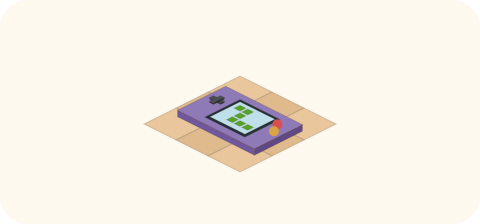

# 2026-11-21（土）
<!-- phrase: 小さなOSのようなもの -->
<!-- phrase_en: Something like a small OS. -->
<!-- themes: つくる1 -->

発酵29日目。inajob の mdesk は、ESP32-S3 の上にデスクトップ環境を作るプロジェクトで、9月から続いている。今日、その実機で日本語入力が動いた。小さな画面の上で日本語が打てるようになったのを見て、ここ数週間、目に入っていた作例のことを思い出した。ESP32 や RP2350、RP2040 の上に、画面つきのデスクトップのようなものを作る試みが、続けて現れている。今日はそれらを並べる特集にした。比べる軸は3つ、アプリの動かし方、画面の形、日本語入力の有無だ。

## 画面のついたOSのようなもの

並べる前に、今日の mdesk の話を置いておく。ESP32-S3 の小さなデスクトップで、画面の更新はもたつくが、キーの取りこぼしはない。速度の問題は、ほぼ想定どおりの出方だったそうだ。inajob は X に、写真2枚と一緒にこう書いた。

<!-- raw -->
<blockquote class="twitter-tweet">
ESP32-S3を使った日本語入力ができるデバイス。なんかできてしまったな。やや画面更新がもたつくがキーは取りこぼさないのでまぁ使える気がする https://t.co/U1VapJgXSj
&mdash; ina_ani@6歳児のパパ (@ina_ani) <a href="https://x.com/ina_ani/status/2124045968496636301?ref_src=twsrc%5Etfw">November 21, 2026</a></blockquote>

<!-- /raw -->

## アプリの動かし方

アプリの動かし方で分けると、こうなる。

- ネイティブ（ELF）：[BMDS](https://github.com/jthwho/bmds)、[bevel-os](https://github.com/andrisgauracs/bevel-os)
- ネイティブ（Zig）：[PowerOS](https://github.com/cycl0ne/poweros_esp32)
- ネイティブ（内蔵プログラム）：[Sylphide OS](https://projects.freehackers.org/sylphide-os/)、[esp32_cyd_pda](https://github.com/sau412/esp32_cyd_pda)
- スクリプト（Lua）：mdesk、[S3_OS](https://github.com/circularchickenthatcodes/S3_OS_for_CYD)
- スクリプト（JavaScript）：[KryonOS](https://github.com/Haris16-code/KryonOS)
- スクリプト（MicroPython・Python）：[TinyDesk](https://github.com/tinydesk-project/tinydesk)、[mote.](https://mote.kellishaver.com/)、[Tulip](https://github.com/shorepine/tulipcc)、[Picoware](https://github.com/jblanked/Picoware)、[MicroHydra](https://github.com/echo-lalia/MicroHydra)
- Wasm：[KoaOS](https://github.com/Koakno/KoaOS-for-the-Heltec-V4)
- バイトコード：[KotoOS](https://github.com/siska-tech/KotoOS)
- ブラウザへ配信：[NucleoOs](https://github.com/indecenti/NucleoOs)（デスクトップ画面を Web ページとして配信する）
- リモート表示：ESP32-S3 の [X11 サーバー](https://github.com/serg5z/woodland-x11)

## 画面の形

画面の形は、窓型デスクトップ、ランチャー型、専用機型の3つに分かれた。画面のあるものは、引用のあとに説明を置く。

[**bevel-os**](https://github.com/andrisgauracs/bevel-os)（ESP32-S3）。Windows 95 風の窓型デスクトップ。起動は0.7秒、Doom が32fpsで動く。OS 本体は Claude Fable 5.2 が書いたそうだ。[andrisgauracs/bevel-os](https://github.com/andrisgauracs/bevel-os) の README より。

[**BMDS**](https://github.com/jthwho/bmds)（ESP32-P4）。ターミナルとファイルマネージャとシステムモニタが並ぶ、窓型デスクトップ。ELF のバイナリをそのまま動かす。[jthwho/bmds](https://github.com/jthwho/bmds) の README より。

[**PowerOS**](https://github.com/cycl0ne/poweros_esp32)（ESP32-S3 と ESP32-P4）。Zig で書かれた窓型デスクトップ。[cycl0ne/poweros_esp32](https://github.com/cycl0ne/poweros_esp32) より。

**[Sylphide OS](https://projects.freehackers.org/sylphide-os/)**（ESP32-P4 と RP2350）。マイコンでできたコンピュータのための汎用 OS で、土台は FreeRTOS、その上に自前のドライバと窓型の GUI が乗る。対象は Olimex の ESP32-P4-PC と、RP2350 の自作ボードと、FabGL で、写真は RP2350 側が VGA モニタに出したデスクトップだ。プログラムは今のところ内蔵で、SD カードから実行ファイルを読み込む形は今後の予定になっている。Thomas Capricelli のプロジェクトで、ソースは Mercurial のリポジトリにある。[Sylphide OS](https://projects.freehackers.org/sylphide-os/) のプロジェクトページより。

[**KryonOS**](https://github.com/Haris16-code/KryonOS)（ESP32 と ESP32-S3）。アプリは JavaScript で、Duktape のランタイムの上にランチャーとファイルマネージャと App Store が乗る。今週、Hackster でも紹介されていた。ホーム画面はデスクトップ型に近い。[Haris16-code/KryonOS](https://github.com/Haris16-code/KryonOS) より。

[**TinyDesk**](https://github.com/tinydesk-project/tinydesk)（ESP32）。マウスで窓を動かすデスクトップ。アプリは MicroPython。今月 v0.3.0 が出て、CrowPanel 7.0 の800×480のタッチ画面でも動くようになった。[tinydesk-project/tinydesk](https://github.com/tinydesk-project/tinydesk) より。

[**NucleoOs**](https://github.com/indecenti/NucleoOs)（M5Stack Cardputer、コアは ESP32-S3）。本体は ESP-IDF で書かれたファームウェアで、本体の小さな画面にも表示はある。ただし本命のデスクトップは、本体が SD カードから配信する Web ページで、同じネットワークにある PC やスマホのブラウザで開いて使う。引用した GIF は、その配信される側の画面だ。重い描画をブラウザ側に寄せるので、PSRAM のない ESP32-S3 でも窓型のデスクトップが成立している。[indecenti/NucleoOs](https://github.com/indecenti/NucleoOs) より。

[**MicroHydra**](https://github.com/echo-lalia/MicroHydra)（M5Stack Cardputer、コアは ESP32-S3）。MicroPython 製のアプリ切り替えで、OS のような顔をしたランチャー型。[echo-lalia/MicroHydra](https://github.com/echo-lalia/MicroHydra) より。

[**mote.**](https://mote.kellishaver.com/)（Waveshare の ESP32-S3 AMOLED ボード）。MicroPython の小さな OS で、タッチで選ぶランチャーがつく。[mote.](https://mote.kellishaver.com/) より。

[**Tulip**](https://github.com/shorepine/tulipcc)（ESP32-S3）。窓型ではなく、起動すると Python のプロンプトとエディタが立ち上がる専用機型。音楽とグラフィックスと文章のためで、MicroPython と LVGL でできている。Makerfabs から59ドルで買える。[shorepine/tulipcc](https://github.com/shorepine/tulipcc) より。

[**Picoware**](https://github.com/jblanked/Picoware)（RP2040 と RP2350、ClockworkPi PicoCalc）。デスクトップ画面を持つファームウェアで、ランチャー型。[jblanked/Picoware](https://github.com/jblanked/Picoware) より。

**[KotoOS](https://github.com/siska-tech/KotoOS)**（RP2040 と RP2350、ClockworkPi PicoCalc）。Rust で書かれた日本の PDA 環境で、Picoware と同じ PicoCalc が対象だ。アプリは独自のバイトコードで動き、ホーム画面はランチャー型。SKK の日本語入力を持ち、引用はメモ帳で変換しているところで、実機と同じ画面を出すシミュレータのものだ。[siska-tech/KotoOS](https://github.com/siska-tech/KotoOS) より。

[**DECK//OS**](https://github.com/hey-its-brian/tab5-cyberdeck)（ESP32-P4、M5Stack Tab5）。キーボード付きのサイバーデック用ファームウェアで、専用機型。[hey-its-brian/tab5-cyberdeck](https://github.com/hey-its-brian/tab5-cyberdeck) より。

[**KodeOS**](https://github.com/kodediy/KodeOS)（ESP32-P4、Kode Dot）。小さなデバイスの OS で、専用機型。[kodediy/KodeOS](https://github.com/kodediy/KodeOS) より。

[**X11 サーバー**](https://github.com/serg5z/woodland-x11)（ESP32-S3、Elecrow CrowPanel Advance 4.3インチ）。アプリは別の機械で動いて、画面だけを出すリモート表示の形。11月14日に IKeJI が Discord に貼っていた。[serg5z/woodland-x11](https://github.com/serg5z/woodland-x11) より。

**[esp32_cyd_pda](https://github.com/sau412/esp32_cyd_pda)**（ESP32、CYD）。Palm OS に触発された PDA のファームウェアで、ノートや連絡先、予定表、家計簿といった PIM のアプリが内蔵されている。アプリは Arduino のコードを書き換えて足す形で、画面はタッチで選ぶランチャー型だ。S3_OS と同じ CYD が対象だが、こちらはデスクトップではなく手帳の形をしている。[sau412/esp32_cyd_pda](https://github.com/sau412/esp32_cyd_pda) より。

**[ESP-Osito](https://github.com/ralsina/esposito)**（ESP32、CYD）。10ドルの CYD を本物のコンピュータとして扱う OS で、Roberto Alsina の作だ。アプリは C か C++ で書き、読み込まれると前のアプリと完全に置き換わる。マルチタスクはしない。起動は1秒未満で、電源を切っても同じアプリが同じ状態で戻る。電子書籍リーダーやファイルマネージャ、ターミナルなどが入り、画面はランチャーから全画面のアプリを開く形だ。[esposito.ralsina.me](https://esposito.ralsina.me/) より。

**[CL-32](https://hackaday.io/project/197467-cl-32)**（ESP32-S3）。これは OS ではなく、その受け皿の専用ハードだ。電子ペーパーと物理キーボードを持つポケット端末で、SolarOS の対象機種の1つになっている。写真は往年のポケコン CASIO PB-100 と並べたもので、画面同士で親子の問答をしている。[Hackaday.io](https://hackaday.io/project/197467-cl-32) より。

画面の引用がない組も書いておく。

- [KoaOS](https://github.com/Koakno/KoaOS-for-the-Heltec-V4)（ESP32-S3）：Wasm のアプリを動的に足せる。土台は FreeRTOS、UNIX 風のシェルとケイパビリティの権限管理がつく。inajob 自身が11月17日にレビューを書いた。リポジトリに画像はない
- [S3_OS](https://github.com/circularchickenthatcodes/S3_OS_for_CYD)（CYD）：ファイルエクスプローラと Lua インタプリタを内蔵し、mdesk と同じ Lua の側。画面写真はなく、アプリアイコンだけがある
- [PyDOS](https://github.com/RetiredWizard/PyDOS)：MicroPython の上で、DOS のような文字の画面を出す
- [SolarOS](https://github.com/nilseuropa/solar_os)（ESP32）：画面つきのポケット端末のための OS で、対象は電子ペーパーや LCD の28機種。表示はテキスト中心で、起動するとシェルが立ち上がる。前面のアプリとバックグラウンドジョブがあり、スクリプトは Lua と Python。動いている画面の公開画像はない。受け皿には専用ハードの [CL-32](https://hackaday.io/project/197467-cl-32) もある
- [thistle-os](https://github.com/wan0net/thistle-os)（LilyGO T-Deck Pro）：画面デザインのコンセプト画の段階

thistle-os の画面デザイン（コンセプト画）。[wan0net/thistle-os](https://github.com/wan0net/thistle-os) より。

## 日本語入力の有無

海外の作例に共通するのは、日本語入力がないことだ。11月19日のいろいろレビューで、ikeji が BMDS に「これで日本語読み書きできればなぁ」と書いていたのは、この軸の話だ。[Sylphide OS](https://projects.freehackers.org/sylphide-os/) のようなミニマルな設計では、IME は真っ先に落ちる要件になる。mdesk が実用の線まで切り詰めても SKK を残したのは、その裏返しだ。日本語で書くには、入力の仕組みがないと、文字を打つこと自体が始まらない。

日本語入力を入れた例もあった。

[**Clientre5**](https://github.com/Mozgi512/Clientre5)（ESP32-P4、M5Stack Tab5）。SSH 端末の OS で、日本語入力に対応している。JIS 配列にカスタマイズしたキーボードを付けた実機の写真がある。ポケットに入る端末として、読むだけでなく打てることが要る、という作りだ。[Mozgi512/Clientre5](https://github.com/Mozgi512/Clientre5) より。

日本語入力のある側には、日本の作例 [KotoOS](https://github.com/siska-tech/KotoOS) もいた。mdesk と同じ SKK で、同じ Rust だ。

動いた直後、inajob は Discord に書いた。速度に課題があるので、Lua の層を入れるのをやめようか、と。

> <!-- speaker: inajob -->
> 速度に課題があるのでLuaの層を入れるのをやめようかな・・

mdesk はもともと C/C++ と Lua で inajob 自身が作っていたものを、OpenCode に Rust+Lua でゼロから書き直してもらったものだ。アプリは Lua のスクリプトとして動く。その層を外すかどうかは、まだ決まっていない。日本語入力が動いた日の、すぐ次の問いだった。

引用した画面は、窓型のデスクトップだけではない。ランチャーも、エディタも、電子ペーパーの端末もある。その中で日本語入力まで入っているのは、mdesk と Clientre5 と KotoOS の3つだけだった。mdesk の今日の写真は、その中ではいちばん地味だ。それでも、今日その入力が動いたのは、地味なほうのデスクトップだった。
